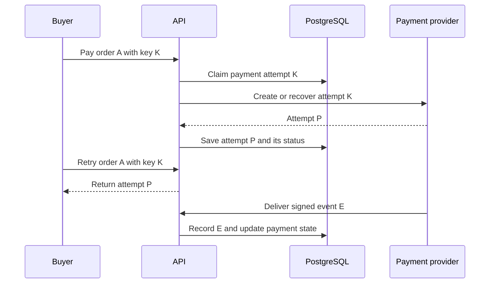

# Preventing duplicate payments on retry

A buyer submits a payment. The network drops after the server has received it, so the buyer sends the same request again. Both requests must converge on the same payment attempt.

## Design

- Create one idempotency key for each intentional payment action. Reuse it when retrying the same action.
- Scope the key to the authenticated account and operation. Store a request fingerprint with it and reject reuse for a different order or amount.
- Send a stable key to the payment provider when creating the attempt. Record the attempt and its state in PostgreSQL using a uniqueness constraint.
- Verify the provider's webhook signature, then apply a permitted state transition once. Use a unique provider event ID or a transactionally guarded state change. For reliable notifications, write an outbox record in the same transaction as the state change.

## What Vendora verifies

[Vendora's payment tests](https://github.com/Samandar2005/Vendora-E-Commerce-API/blob/master/tests/test_payments.py) exercise Stripe Checkout response handling, payment visibility, refunds, and repeated webhook delivery. Provider calls are simulated in the suite. The [PostgreSQL concurrency test](https://github.com/Samandar2005/Vendora-E-Commerce-API/blob/master/tests/test_order_concurrency_postgres.py) verifies an adjacent checkout invariant: only one of two buyers can reserve the last item, even when both sessions previously read the old stock count.

A complete payment retry test would also simulate a lost checkout response and verify that parallel requests with the same key return one provider attempt. A second test would redeliver one signed event concurrently and assert one state transition and one outbox record.

[Stripe idempotent requests](https://docs.stripe.com/api/idempotent_requests) · [Stripe webhook delivery](https://docs.stripe.com/webhooks)
